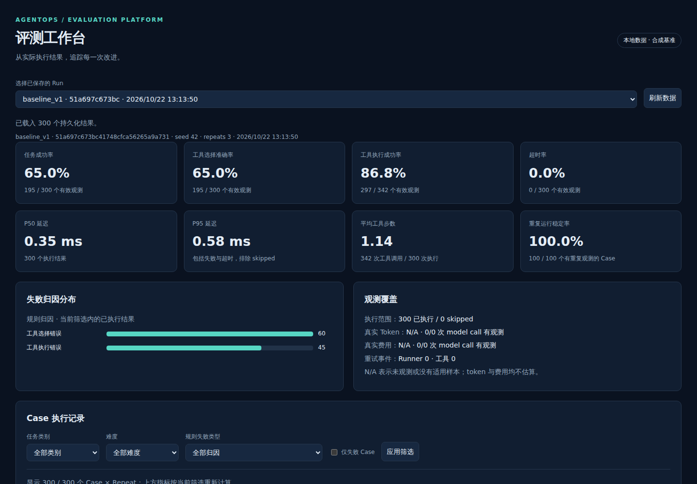
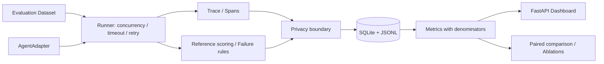

# AgentOps Evaluation Platform

[](https://github.com/FouHe0720/agentops-eval-platform/actions/workflows/ci.yml)

**让 Agent 的版本变化可以被测量、追踪和回归验证。** 输入标准化 Dataset 与 AgentAdapter，执行隔离任务，保存层级 Trace，再查看指标、失败归因和公平的版本比较。默认纯 CPU、离线、无模型下载、无付费密钥。

**English overview.** A framework-neutral, offline-first agent evaluation platform with typed datasets, hierarchical traces, SQLite persistence, explicit metric denominators, paired case-cluster bootstrap comparisons, controlled ablations, and a local dashboard. The included benchmark is synthetic; its results are not production-quality claims.



## 解决什么问题

一个 final answer 无法解释 Agent 为什么失败。本项目同时保存工具选择、执行错误、重试与耗时，用固定基准回答“哪类任务退步了、执行路径哪里变了、比较是否公平”。

- **标准契约**：Pydantic EvalCase / EvalResult / AgentRunTrace；100 条原创合成 Case，30 算术、30 检索/多工具、20 恢复、20 长数组/显式异常输入；seed=42 可逐字节重建。
- **真正执行**：内置 DeterministicBaselineAgent 调用内存 fixture 工具，产生 agent → tool_call → tool_result → final；另有真实 HTTP 和 OpenAI-compatible Adapter。没有模型调用时不伪造 model spans、tokens 或 cost。
- **可观测与归因**：SQLite WAL、JSON/JSONL；严格工具调用顺序、规则归因、人工标注、难度/类别/失败过滤与可展开 Trace。
- **公平比较**：完整数据摘要、同 case/repeat/config/seed 检查；按 case 聚类 bootstrap，重复运行不当作独立样本；三种单变量消融。
- **可重复交付**：统一 CLI、Makefile、锁文件、免费 deterministic CI、非 root Docker。

## 架构



职责、指标定义和持久化边界见 [ARCHITECTURE](docs/ARCHITECTURE.md)，取舍见 [TECH_DECISIONS](docs/TECH_DECISIONS.md)。

## Quick Start：无密钥

需要 Linux/WSL、Python 3.11+ 和 [uv](https://docs.astral.sh/uv/getting-started/installation/)。本次 WSL 已有 uv；系统 Python 缺少 ensurepip，所以采用项目内 uv 环境，无需 sudo。

```bash
git clone https://github.com/FouHe0720/agentops-eval-platform.git
cd agentops-eval-platform
make install
make demo
make serve
```

浏览器打开 <http://127.0.0.1:8000>。`make demo` 默认执行 **5 个配置 × 100 cases × 3 repeats**，写入 `runtime/demo.db`，生成 `reports/comparison.md`、`reports/results.json`、`reports/ablations.md` / `.json`。只访问本地 fixtures。再次运行追加唯一 Run，不覆盖历史数据库记录；导出的同名报告更新为最新执行。

`runtime/` 的数据库和完整导出默认不进 Git。克隆后需运行 Demo 才有 Dashboard 数据；仓库保留已审查的合成评测摘要及 [真实 Trace 片段](reports/example-trace.jsonl)。

如果使用自带 ensurepip 的 Python，也可 `python3 -m venv .venv`、`.venv/bin/python -m pip install -e '.[dev]'`；这会按版本范围解析。推荐 `uv sync --frozen --extra dev` 使用本次锁文件。

## CLI 与示例

```bash
# 同一个数据子集、seed 和配置比较两个执行版本
.venv/bin/eval run --dataset datasets/synthetic.json --agent baseline_v1 \
  --limit 10 --seed 42 --repeats 3 --output runtime/v1.json
.venv/bin/eval run --dataset datasets/synthetic.json --agent candidate_v2 \
  --limit 10 --seed 42 --repeats 3 --output runtime/v2.json
.venv/bin/eval compare --baseline runtime/v1.json --candidate runtime/v2.json \
  --output runtime/paired.json

# 过滤、保存与重启后读取
.venv/bin/eval run --dataset datasets/synthetic.json --agent baseline \
  --category recovery --difficulty medium --seed 42 --output runtime/recovery.json
.venv/bin/eval inspect --db runtime/evaluations.db
.venv/bin/eval serve --db runtime/demo.db
```

`baseline` 是当前默认确定性实现 `candidate_v2` 的 CLI 别名；比较历史策略时显式使用 `baseline_v1`。`--limit` 用 seed 抽取子集；`--case-id` 可重复指定，空集、重复 ID、非法配置均被拒绝。

可审查输入示意（完整数据在 `datasets/`）：

```json
{
  "case_id": "arithmetic-example", "task": "Add 2 and 3", "category": "arithmetic",
  "expected_answer": "5", "expected_tool_sequence": ["calculator"],
  "fixtures": {"operation": "add", "a": 2, "b": 3}
}
```

Agent 只接收任务和 fixture，预期答案/断言/工具序列在进入 Adapter 前被剥离。CLI 输出实测 metrics 与 run_id；默认保存文件中的 task/fixtures/answer 正文被移除，评分和工具轨迹保留。

API 提供 `GET /runs`、`GET /runs/{id}`、`GET /metrics`、`GET /compare`、`GET/POST /runs/{id}/annotations`；[DEMO](docs/DEMO.md) 有动态读取 run_id 的完整 curl 演示。

## 真实 LLM 与外部 Agent

`.env.example` 列出所有变量；CLI **不自动读取 `.env`**，通过 shell export 传入。默认不连接任何远端。

```bash
# 以下 URL/model 是配置示意，需替换成你实际有权访问的服务
export OPENAI_BASE_URL='https://llm.example/v1'
export OPENAI_MODEL='your-model'
# 需要认证时，在当前 shell 安全设置 OPENAI_API_KEY；不写进命令历史或仓库
.venv/bin/eval run --dataset datasets/synthetic.json --agent openai \
  --category arithmetic --limit 3 --output runtime/llm.json
```

OpenAI-compatible Adapter 真正请求 `/chat/completions`，仅声明 arithmetic/long_input 能力；不提供平台 fixture 工具，因此工具顺序指标可能失败，不据此伪装其具备工具能力。usage 来自服务实报；未知 token/cost 为 null。不同服务的 seed 支持不同，本实现不声称网络模型确定性。

Workspace / Research 通过 `WORKSPACE_AGENT_ENDPOINT` / `RESEARCH_AGENT_ENDPOINT` 显式接入，配置可选 API key；运行 `--agent workspace` 或 `--agent research`。接口包含 seed 和执行配置，但远端必须自行实现。其它仓库无需在本机，也不会被修改；未配置时只有显式选择该 Adapter 的 run 记录连接失败。详情见 [ADAPTER_CONTRACT](docs/ADAPTER_CONTRACT.md)。

**验证范围：外部协议用 MockTransport 测试；本交付未调用真实 LLM、workspace-agent 或 deep-research-agent 服务。**

## 已执行的合成评测

固定 100 cases、seed=42、每 case 重复 3 次。完整分母、逐 case 变化和实测延迟见 [results.json](reports/results.json)，运行身份见 [run_manifest.json](reports/run_manifest.json)。

| 策略 | Task Success | Tool Selection |
|---|---:|---:|
| baseline_v1：基础工具选择，无内部工具恢复 | 195 / 300 | 195 / 300 |
| candidate_v2：歧义工具选择与有限恢复 | 300 / 300 | 300 / 300 |

绝对成功率差值 **+35 percentage points**，100 个 case clusters 的 2000 次 bootstrap 95% 区间为 **[+26, +44] pp**。这是特意覆盖机制边界的合成基准；候选版本与数据一起设计，不能用于宣称泛化能力或生产收益。

消融相对完整 candidate：关闭 Planner **−26 pp**、基础 tool descriptions **−20 pp**、禁用工具内部重试 **−15 pp**。它们改变实际执行路径，详见 [ablations.md](reports/ablations.md)。所谓 tool description 改进在确定性示例中是显式的歧义工具路由策略，不是实测 LLM prompt 优化。

候选任务全成功，工具执行成功率仍低于 100%，因为合成瞬态 fetch 的第一次调用真实失败后重试成功。离线示例没有 model calls，所以 Token Usage、Cost 为 **null**。单机毫秒延迟只是此 fixture 实现的观测，不当作真实模型性能。

## 测试、CI 与 Docker

```bash
make lint
make test
make regression
.venv/bin/python scripts/privacy_check.py
.venv/bin/python scripts/generate_dataset.py
git diff --exit-code -- datasets/
```

本地实际结果：**213 pytest passed，无 warnings**；Ruff lint/format 通过；10-case deterministic 回归答案与工具顺序均 10/10；数据重建无 diff；wheel 包含 Dashboard HTML。测试覆盖空评分、分母、重复 case ID、错误/跨 run trace、超时、重试、配置隔离、分类、paired/bootstrap、序列化、脱敏、API 与暂存区审核。

CI 对 Python 3.11/3.12/3.13 执行同一免费测试与回归，不使用密钥。远端实际状态见页首 badge；本机验证及远端记录见 [VALIDATION](docs/VALIDATION.md)。

```bash
docker compose build
docker compose run --rm evaluation .venv/bin/python scripts/demo.py \
  --reports-dir runtime/reports
docker compose up -d
curl http://127.0.0.1:8000/health
docker compose down
```

已真实执行 Docker build、禁网容器内 regression/Demo、非 root UID 10001 和容器 HTTP health/Dashboard；Compose 完整 regression / Demo / up / API / down 流程通过。上面的 Compose 数据使用 named volume，`down` 保留数据。首次构建需拉取公开基础镜像和 PyPI 依赖；运行离线 Demo 可 `--network none`。详见 [DEMO](docs/DEMO.md)。

## 设计取舍、安全边界与扩展

- 成功率只统计有参考且能力适用的样本；无适用分母为 null。工具序列包含失败重试，任务成功和工具选择分别计分。归因采用可判定规则；unclassified 支持独立人工标注，标注不覆盖原始数据。
- 同时保存 Trace 和可导出数据，便于定位问题；SQLite 面向单机，完成 run 后一次落库，进程强杀不保证保存进行中结果。跨机调度、流式 checkpoint、PostgreSQL 可作为后续扩展。
- 超时为协作式 asyncio 总预算；同步阻塞 Adapter 不能被硬终止，返回后才能判超时。内置工具只有内存 fixture 隔离，不是运行任意代码的沙箱。远端 runner retry 默认 0；启用重试需远端保证幂等。
- 默认丢弃正文与任意 metadata，已覆盖常见 header/JSON 密钥脱敏；显式 `--sensitive-trace` 会保留内容并仍做模式脱敏，无法识别所有秘密。脱敏后的 run 用于审计/比较，不承诺从中重评分或恢复输入。
- Dashboard 默认 loopback，无账号系统；公网部署需要认证、TLS 与访问控制。只有人工标注写接口，不暴露任意执行、上传或文件读取接口。
- 数据是原创合成 fixtures，长任务是最多 256 项数组聚合，异常输入有显式标记；未覆盖真实仓库文件系统、多跳研究、长上下文模型、模型工具调用循环或生产数据漂移。这些需接入真实 adapter 与独立业务评测集后验证。

求职阅读顺序与 10 个基于源码的问题见 [INTERVIEW_GUIDE](docs/INTERVIEW_GUIDE.md)；简历措辞见 [RESUME_BULLETS](docs/RESUME_BULLETS.md)。

## License

[MIT](LICENSE)。示例数据为本仓库原创合成数据，按相同许可证发布。
