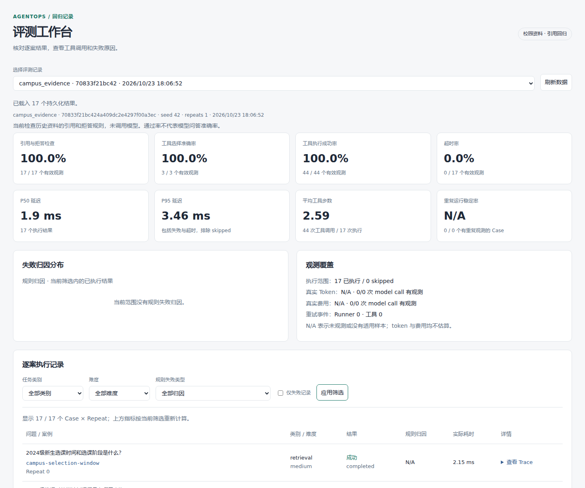
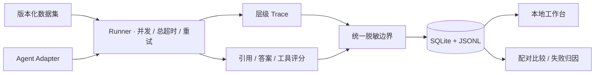

# AgentOps Evaluation Platform

[](https://github.com/FouHe0720/agentops-eval-platform/actions/workflows/ci.yml)

一个本地 Agent 评测工作台。把任务、工具调用和评分放在同一条记录中，方便核对版本改动后哪些问题退步了。Python / FastAPI / SQLite，默认离线运行。

现在有两组数据：山东大学威海校区历史资料构成的校园查询回归集，以及用于验证执行机制的合成基准。两组独立运行、分别解释结果。

[运行校园示例](#运行校园示例) · [资料与评分](docs/CAMPUS_SCENARIO.md) · [架构](docs/ARCHITECTURE.md) · [API 与适配器](docs/ADAPTER_CONTRACT.md)

## 校园查询场景

学生问“翻译学院要参加统一英语分级测试吗”，回答必须保留通知中的例外；问“2026级选课时间”，手头的 2024 年通知不能直接套用。培养方案也要区分专业和版本：同为 2024 版，计算机与人工智能的弹性修业年限分别是 3 至 6 年、4 至 6 年。

回归集取自现有 RAG 知识库的 **8 份 DOCX 摘录**，覆盖选课、英语分级、实验班招生与培养方案。问题和引用标准单独编写，没有混入原来的 100 条合成数据。

| 检查 | 数据与行为 |
| --- | --- |
| 来源可追溯 | 保存相对原文路径、原文件/摘录 SHA-256 和原始段落序号 |
| 引用可核对 | 14 条检查要求返回已知来源及对应原文，不能只写一个引用编号 |
| 范围与拒答 | 3 条覆盖未收录事项、校区不符和资料版本不符 |
| 评分隔离 | Adapter 收到任务与资料；参考答案、断言和预期工具序列在调用前移除 |
| 观测完整性 | 记录实际 search/read 工具调用；没有模型调用时 token、费用为 null |

**随仓库提供的是词法检索基线**：先按请求范围过滤，再返回相关资料原文，不生成政策解释。本次 17/17 表示引用和拒答检查通过，不能当作 LLM 问答准确率。资料属于 2023/2024 年历史版本，不代表当前政策。详见[逐案记录](reports/campus-regression.md)。



## 运行校园示例

需要 Python 3.11+ 和 uv。无需 API Key、GPU 或模型下载。

```bash
make install
make campus-demo
make campus-serve
```

打开 <http://127.0.0.1:8000>。第一条命令运行 17 个案例，写入 `runtime/campus.db` 和本地导出，并更新 `reports/campus-regression.{json,md}`。工作台可筛选结果、展开工具 Trace、单独保存人工归因。校园 Demo 只为这组已审查的摘录显式保留问题与输出，便于展开核对；通用 CLI 默认仍删除正文。数据库与完整导出不进 Git。

```bash
# 独立运行并保存
.venv/bin/eval run --dataset datasets/campus.json --agent campus_evidence \
  --output runtime/campus.json --db runtime/campus.db

# 校验摘录指纹并重建数据集
.venv/bin/python scripts/build_campus_dataset.py
```

`datasets/campus.json` 自带每个任务需要的文档快照，不依赖原始知识库在本机的路径。`source_quote` 评分检查完整原文和已知引用；它不判断自由改写是否正确，也不自动发现附加的无依据结论。换用生成式 Agent 时需要补充事实级评分和人工抽检。

## 执行与比较



Runner 把单个任务失败限制在该案例内，区分执行重试与工具内部重试。比较要求数据摘要、案例、repeat、seed 和配置兼容；bootstrap 按 case 聚类，多跑几次不会增加独立问题数量。指标保留分母，缺少观测时保留 null。

原有合成示例继续可用：

```bash
make demo       # 100 cases × 3 repeats，基线/候选及三个消融
make serve     # 打开 runtime/demo.db
make regression
```

历史合成报告中，基础策略为 195/300，候选策略为 300/300；差异来自确定性的工具选择和瞬态恢复实现。这是机制检查，不是线上业务提升。[结果与分母](reports/results.json) · [消融记录](reports/ablations.md) · [数据集定义](datasets/README.md)。

## 接入外部 Agent

已提供 `workspace` / `research` HTTP Adapter 和 OpenAI-compatible 文本 Adapter。HTTP 接口可接收校园 retrieval 任务，服务端自行实现检索与作答；内置 OpenAI 文本 Adapter 仅声明 arithmetic/long_input，直接用于校园集会跳过。

远端地址、密钥和能力范围见 [ADAPTER_CONTRACT](docs/ADAPTER_CONTRACT.md)。CLI 不自动读取 `.env`。本次没有调用付费模型或远端 Agent，协议验证使用模拟传输。

## 验证与取舍

```bash
make lint test regression
.venv/bin/python scripts/privacy_check.py
```

测试覆盖执行隔离、超时、评分分母、配对比较、脱敏与 API；校园部分另外核对来源重建、伪造引用、范围过滤和评分参考隔离。CI 使用免费离线任务；Docker 与既有验证记录见 [VALIDATION](docs/VALIDATION.md)。

服务面向本地单机，默认监听 loopback。SQLite 在 run 完成后一次落库；协作式 asyncio 超时无法强制终止阻塞代码。默认导出删除任务/答案正文，不能从脱敏存档独立重评分。公网使用需要补齐认证和访问控制。

代码按 [MIT](LICENSE) 发布。学校资料的权利归原作者，代码许可证不覆盖第三方摘录；这里未附整库文件或个人联系方式。[来源说明](datasets/campus/sources/manifest.json) · [实现取舍](docs/TECH_DECISIONS.md) · [代码导读](docs/CODE_WALKTHROUGH.md)。
