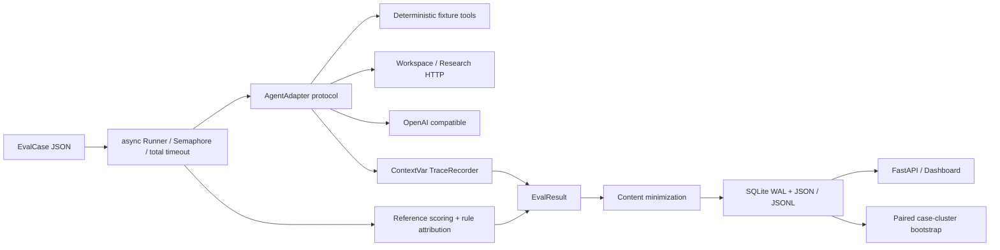

# 架构与指标契约

## 模块交互

- `domain/models.py`：Pydantic 严格字段、输入上限、trace 父节点先存在/无环、run/result 身份与 repeat 覆盖验证。
- `services/runner.py`：每 case/repeat 独立 recorder 与 fixtures 副本，adapter 看不到答案/断言/预期工具；每次尝试配置再复制。能力不支持标 skipped，单 case 失败不取消其它 case。总超时覆盖 runner retries，排队时间不计 case latency。
- `adapters/`：内置 agent 只从 fixture 做算术、文件匹配与读取、模拟瞬态 fetch、聚合和显式 invalid 验证。没有 LLM 的执行不制造 model_call。HTTP 支持外部服务的显式连接契约；标准 chat/completions 适配器只观测真实响应。
- `services/tracing.py`：agent 根 span 下嵌套工具调用和工具结果、final；远端 Agent 可引入 model/tool 层级；ContextVar 支持并发兄弟工具。duration 用 monotonic clock，timestamp 用 UTC。
- `infra/`：保存前统一默认内容抑制与 secret pattern 脱敏。SQLite 参数化查询，连接在事务后关闭；JSON 和 JSONL 遵守同一规则。人工归因保存在独立表，保留原始评分。

## 指标定义

| 指标 | 分子/分母或定义 |
|---|---|
| Task Success Rate | 正确答案及全部 assertions / 有参考的非 skipped case-repeat；timeout/error 计失败 |
| Tool Selection Accuracy | 实际 tool_call 名称完整有序列表（含失败重试）等于 expected_tool_sequence / 提供此字段的非 skipped case-repeat |
| Tool Execution Success | status=ok 的 tool_call / 所有 tool_call；不把 tool_result 再计一次 |
| Average Steps | tool_call 数 / 非 skipped case-repeat |
| P50/P95 Latency | 每个非 skipped case-repeat 的实测总执行毫秒；线性插值分位数 |
| Token Usage / Cost | 有观测的 model_call 求和，同时报告观测数/总数；无观测为 null，非零消费估算 |
| Timeout Rate | timeout / 非 skipped case-repeat |
| Stability | 至少两次有参考重复且 success 一致的 case / 至少两次有参考重复的 case；衡量二元评分一致性 |

无适用样本的指标值均为 null。答案正确但工具顺序错误时，Task Success 可为 true，failure 仍记录 tool_selection_error；两个维度独立。规则归因优先使用 adapter 明确的可判定信号，其次工具顺序和答案比较。没有证据不推测 unsupported_claim，保留 unclassified 或由人工标注。

## 比较的公平边界

dataset digest 基于未脱敏的规范化完整 case JSON；比较保存文件无需恢复私密正文。需要相同 digest、case/repeat、seed 与配置。默认禁止配置差异；显式消融只允许 planner/tool_descriptions/tool_retries。按 case 平均各 repeat 的 success delta，固定 seed 做 2000 次 case-cluster bootstrap。少于 10 个有效 case 不给区间。报告同时保留全样本各指标与共同可评分对数；不同能力覆盖不能据此宣称全域提升。

## 持久化边界

正常执行完成后一次事务保存 run；trace JSONL 是真实执行 span 导出。突然 kill 或断电不保证进行中的 run 保存。没有分布式任务队列或自动恢复调度。HTTP Dashboard 读本地 SQLite，唯一写入口为显式人工标注，不提供运行任意命令或读取任意文件的接口。

## 校园资料扩展

`adapters/campus.py` 是独立的原文检索 Adapter；`source_quote` 断言由 `services/scoring.py` 验证已知文档编号及对应原文。数据重建脚本校验摘录指纹和段落一致性。Runner、统一隐私边界和比较规则保持共用，细节见 [校园场景](CAMPUS_SCENARIO.md)。
